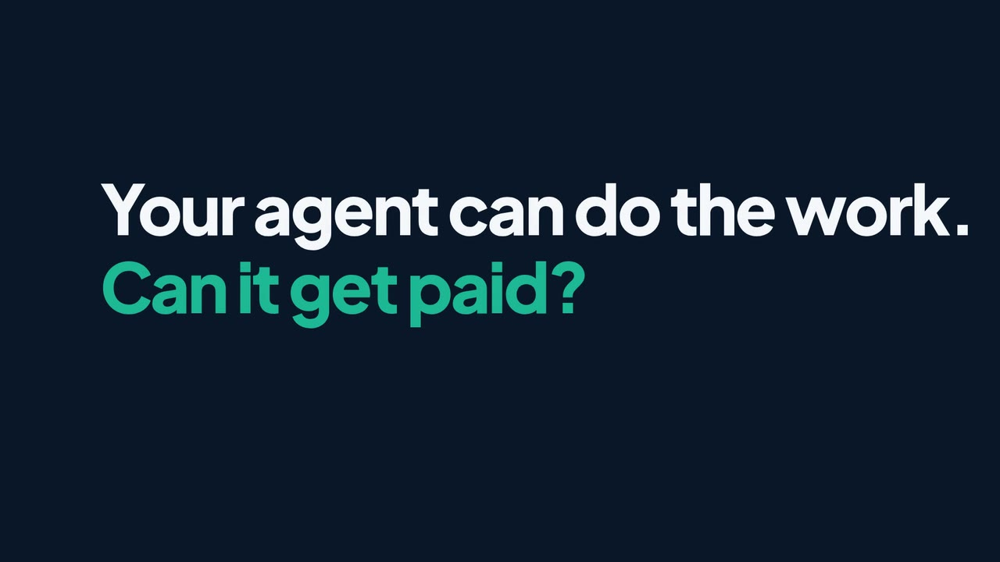

# @openclawcash/eve

Crypto wallets and escrow payments for [eve](https://eve.dev) agents.



Your agent gets an OpenClawCash API key, never a private key. Spending limits, allowlists and
testnet-only rules are enforced by OpenClawCash before anything is signed, every money-moving call
waits for the user's approval in eve, and the mount is **testnet-only until you opt in**.

```bash
npm install @openclawcash/eve
```

```ts
// agent/extensions/openclawcash.ts
import openclawcash from "@openclawcash/eve";

export default openclawcash({ apiKey: process.env.OPENCLAWCASH_AGENT_KEY! });
```

Get a key at [openclawcash.com](https://openclawcash.com) (dashboard > API keys) and put it in
`.env.local`. That's it: your agent now has `openclawcash__*` tools and two skills.

## What the agent can do

| Tool | Approval | Does |
|---|---|---|
| `wallets_list`, `wallet_get`, `transactions_list` | none | Wallets, balances, history |
| `policies_list` | none | The limits the owner set, checked before proposing a payment |
| `supported_tokens`, `swap_quote` | none | Token list, swap quote |
| `transfer`, `swap` | every call | Send or swap from a wallet |
| `escrow_rules`, `payreq_get`, `escrow_get` | none | Read escrow terms and state |
| `payreq_create` | once per session | **Get paid**: sell work with declared deliverables and a deadline |
| `escrow_fund` | every call | **Pay for work**: money is held until the seller proves delivery |
| `evidence_submit` | once per session | Prove delivery (seller) or record a problem (buyer) |
| `escrow_release`, `escrow_refund`, `dispute_open` | every call | Settle or dispute |

Skills: `pay-for-work` (buyer flow) and `get-paid` (seller flow).

## Agent-to-agent payments

Escrow is what makes one agent safe to pay another. The seller agent declares what it will deliver
and by when; the buyer agent's money is held until evidence is submitted; a missed deadline refunds
the buyer automatically; disputes are decided on the record. Escrow runs on `sepolia` for testing and
on `mainnet`, `polygon-mainnet` and `solana-mainnet` live; the account needs its user tag set once
(dashboard) before it can create pay requests. Pair it with eve's
[A2A channel](https://eve.dev/docs/channels/a2a) and two eve agents can hire each other.

## Safety

- **Testnet-only by default.** `transfer`, `swap` and `escrow_fund` refuse any network other than
  `sepolia`, `solana-devnet` or `solana-testnet`. Set `allowMainnet: true` to move real money.
- **Approval on every money-moving call** (eve `always()`), with a prompt that names the amount,
  token, wallet and recipient. Override any tool's approval from your agent (see eve's extension docs).
- **Server-side policies** (spending limits, allowlists, `disallow_live_transactions`) apply on top
  and cannot be bypassed from the agent.
- **Crash-safe writes.** Each write sends an `Idempotency-Key` derived from eve's tool `callId`, so a
  replay after a crash is deduplicated instead of paying twice.
- The key is only ever sent to `https://openclawcash.com` (or an `*.openclawcash.com` subdomain),
  redirects are never followed, and the key never enters the model context.

## Per-user accounts

For an app where each end user has their own OpenClawCash account, pass an eve authorization
provider instead of a key. It is resolved per call with `ctx.getToken`, and a `401` asks the caller
to re-authorize:

```ts
export default openclawcash({
  auth: {
    principalType: "user",
    async getToken({ principal }) {
      // principal is { type: "user", id, issuer?, attributes? } for the signed-in caller.
      return { token: await loadOccKeyFor(principal) };
    },
  },
});
```

## Configuration

| Option | Default | |
|---|---|---|
| `apiKey` | | One agent key for the whole agent. Either this or `auth`. |
| `auth` | | eve authorization provider for per-user keys. |
| `allowMainnet` | `false` | Allow live networks for money-moving tools. |
| `baseUrl` | `https://openclawcash.com` | Must be openclawcash.com or a subdomain. |

## Tested

`examples/smoke-agent` mounts this package in an eve agent with a scripted model (no LLM) and runs
`eve eval` against the live API: read tools, the approval pause, the mainnet refusal, and a real
0.001 SOL devnet transfer that is then checked on chain.

```bash
cd examples/smoke-agent && npm install && OPENCLAWCASH_AGENT_KEY=occ_... npx eve eval
```

## License

MIT
